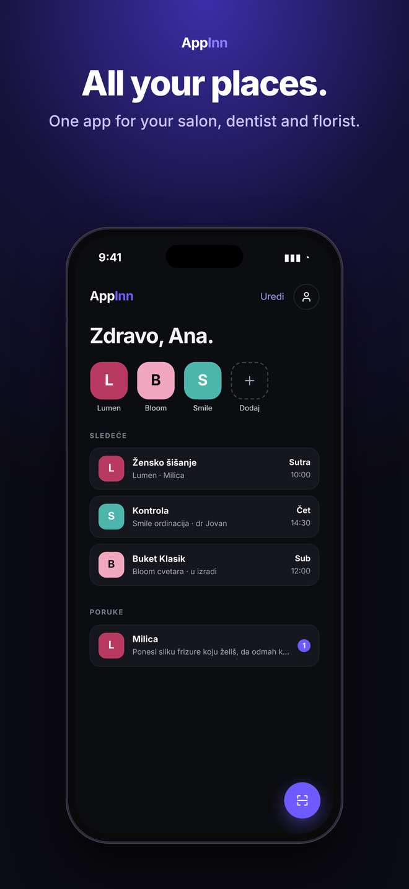
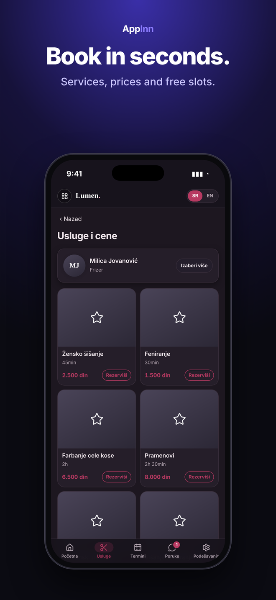
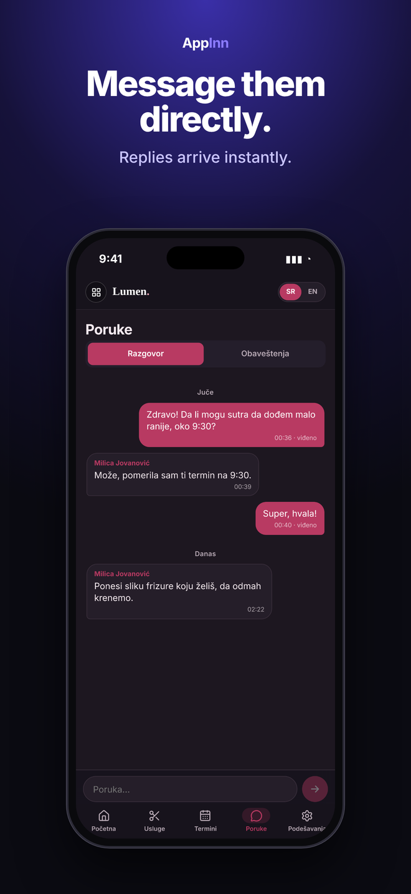
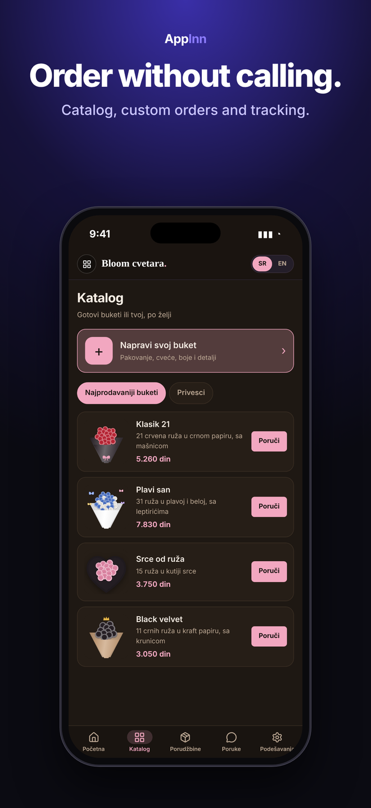
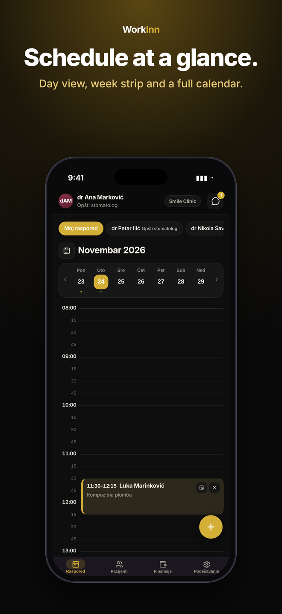
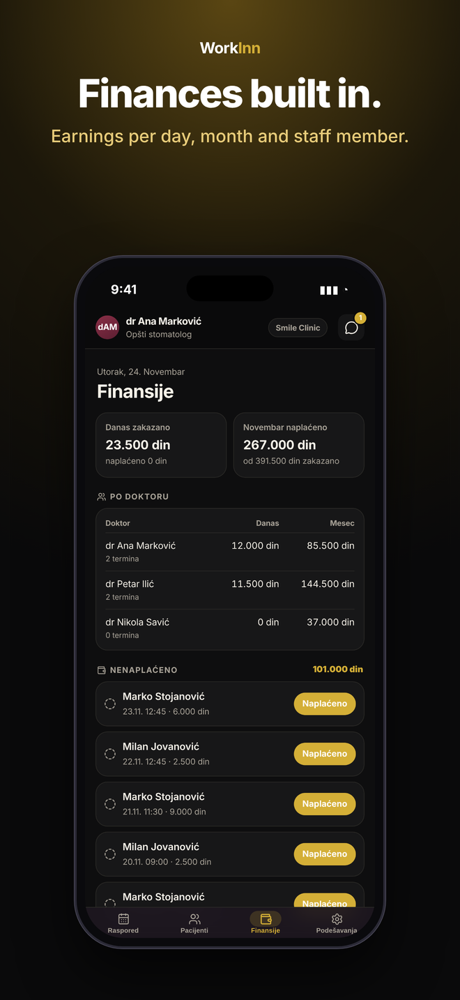
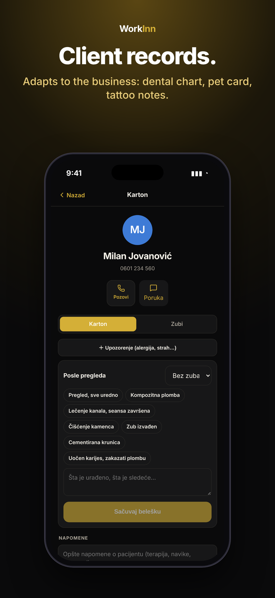
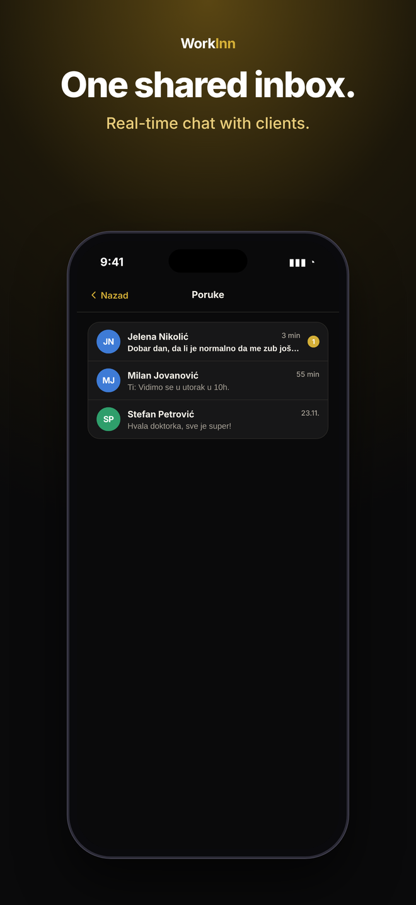
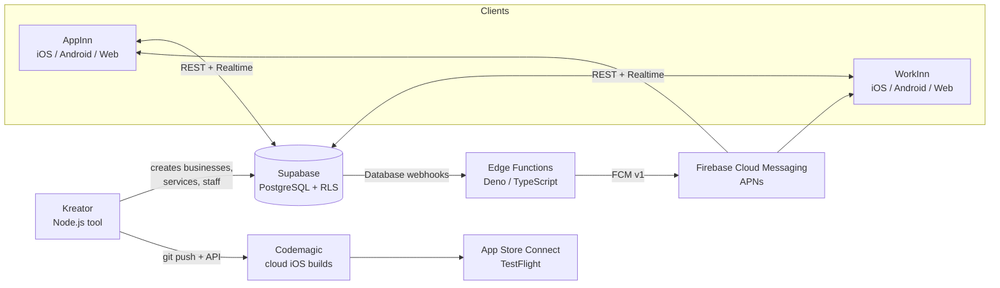

# AppInn Platform

**A booking and ordering platform for small businesses: one client app, one staff app, and an app builder that sets up a new business in minutes.**

iOS · Android · Web &nbsp;|&nbsp; React · Capacitor · Supabase · Firebase

*WorkInn is live on the App Store. AppInn is in App Store review.*

---

## The idea

Small businesses (salons, barbers, dental clinics, florists) need online booking but don't want to pay for and maintain their own app. Their customers don't want ten separate apps either.

The platform solves both sides:

| | App | Who uses it |
|---|---|---|
| 🟣 | **AppInn** | Customers. One app that holds all the places they go. Scan a QR code at the counter and that business's app appears inside AppInn, in its own colors. |
| 🟡 | **WorkInn** | Staff. One universal app for every business: schedule, clients, finances and chat. It adapts to the type of business. |
| ⚙️ | **Kreator** | Me. An internal tool that turns a business's details into a ready app inside AppInn, with no new build and no App Store review. |

---

## AppInn: the client app

- **One login for every business.** Google, Apple or email. Profile details are entered once.
- **"Up next" home screen.** Appointments, orders and unread messages from every business on one screen.
- **Two templates.** *Booking*: pick a staff member, a service and a free slot. *Catalog and orders*: products, a custom-order builder with live price, and delivery or pickup.
- **Real-time chat** with the business, plus push notifications titled with the business name.
- **QR codes and deep links** (`appinn://a/<business>`) add a business in one scan.

## WorkInn: the staff app

- **Schedule:** day timeline, week strip, month calendar, booking on behalf of a client, blocking time, moving appointments.
- **Finances:** earnings per day, month and staff member, and paid or unpaid tracking. The owner sees the whole team.
- **Adapts to the business type.** Labels, settings and the client record change per vertical. Examples: dental chart and patient file for clinics, pet profile for groomers, consent and deposit for tattoo studios, training plan for coaches.
- **Shared inbox** for client messages, plus push notifications for new and cancelled bookings.
- **Personal themes** (gold and black by default) and configurable reminders.

---

## Architecture

**How it works**
- One shared **PostgreSQL** database for every business. **Row Level Security** isolates businesses and clients, using `security definer` helper functions to avoid policy recursion.
- **Edge Functions** react to database webhooks (new or changed appointments, orders, messages, announcements) and to a 15-minute cron for reminders and auto-cancelling unpaid orders. Notifications are sent through the FCM HTTP v1 API with a service-account JWT.
- **Capacitor** wraps one React codebase as native iOS and Android apps: native Google and Apple sign-in, camera QR scanning, push notifications.
- **iOS builds run in the cloud** (Codemagic), triggered from Kreator, so no Mac is needed. Build numbers, signing and App Store upload are automated.

## Tech stack

| Area | Tools |
|---|---|
| Frontend | React 19, Vite, JavaScript, CSS, Framer Motion, lucide-react |
| Mobile | Capacitor 8 (iOS / Android), Xcode project, Android Studio / Gradle |
| Backend | Supabase: PostgreSQL, Auth, RLS, Storage, Realtime, Edge Functions (Deno, TypeScript), webhooks, cron |
| Notifications | Firebase Cloud Messaging, APNs, Resend (email) |
| Auth | Google Sign-In (OAuth), Sign in with Apple, email |
| Build and release | Codemagic, App Store Connect, TestFlight, Google Play Console, Vercel, Git / GitHub |
| Testing | Playwright (UI tests with mocked APIs, automated screenshots and demo videos) |
| Tooling | Node.js (Kreator), VS Code, AI-assisted development (Claude) |

## My role

I designed and built the whole platform on my own: product idea, UI/UX, database design, backend functions, native builds and App Store / Google Play publishing. I also handle onboarding real businesses (a beauty salon, a florist and a dental clinic).

---

The source code is private because this is a live product. The screenshots use demo data; names and businesses shown are fictional. Happy to walk through the code in an interview.
